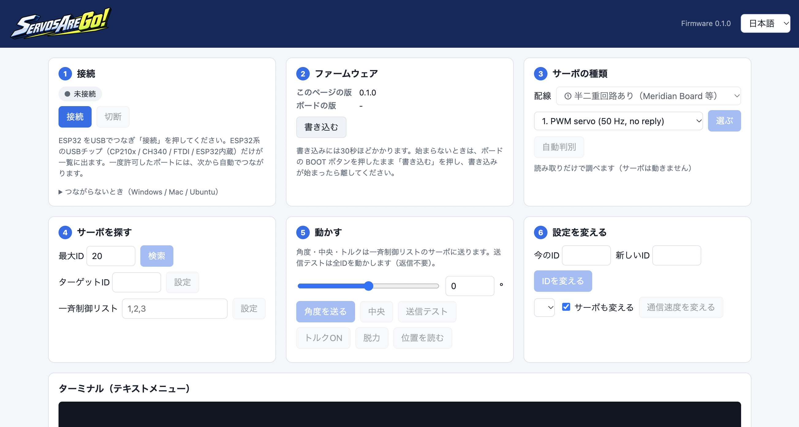

<p align="center">
  
</p>

# ServosAreGo

ESP32 で、各社のシリアルサーボと PWM サーボの **ID・通信速度の変更や動作テスト** ができるツールです。
ブラウザだけで、ファームウェアの書き込みから操作までできます。

対応：PWM / Feetech STS・SCS / Dynamixel / Futaba TTL / JR XBUS / Hitec HSR / Kondo KRS

<p align="center">
  
</p>

## ブラウザ版の使い方

### 1. ファームウェアを書き込む

1. このブランチからDLした [`web/ServosAreGo.html`](web/ServosAreGo.html) を、PC の **Chrome** で開きます（インストール不要。ファームウェアも HTML に入っています）。
2. ESP32（Meridian Board）を USB で PC につなぎ、**① 接続** の「接続」を押してポートを選びます。
3. **② ファームウェア** の「書き込む」を押します（30 秒ほど）。
   始まらないときは、ボードの BOOT ボタンを押したまま「書き込む」を押し、書き込みが始まったら離します。

「ボードの版」が「このページの版」と同じになれば完了です。次からは接続するだけで使えます。

### 2. サーボをつなぐ（Meridian Boardを使用する場合）

サーボを Meridian Board の **L 系統** につなぎ、サーボの定格電圧に合った電源を入れます。

> [!WARNING]
> **信号の電圧に注意してください。** Meridian Board の信号線は **5 V** です。
> - Kondo・Futaba・PWM サーボなど、**5 V の信号で使えるサーボ** をつないでください。
> - **信号が 3.3 V のサーボは、Meridian Board に直接つながないでください。** 3.3 V へのレベル変換が必要です。

### 3. 操作する

| | 画面 | やること |
|:-:|---|---|
| 3 | **サーボの種類** | 配線は「① 半二重回路あり（Meridian Board 等）」。種類を選んで「選ぶ」、わからなければ「自動判別」（読み取りだけなのでサーボは動きません） |
| 4 | **サーボを探す** | 「検索」で ID を探します。見つかったサーボがターゲット ID と一斉制御リストに入ります |
| 5 | **動かす** | 「送信テスト」で全 ID を ±30° 往復させます（返信が読めなくても動きます）。スライダーで角度を送れます |
| 6 | **設定を変える** | ID と通信速度を変えます。**ID を変えるときはサーボを 1 台だけ** つないでください |

※サーボが見つからない場合、メーカーをプルダウンで指定してから自動判別ボタンを押してみてください。

画面下の **ターミナル** では、次のテキストメニューもそのまま使えます。

---

## 対応サーボ

| 番号 | 種類 | 主な機種 | 工場出荷時の速度 | ID |
|:-:|---|---|---|---|
| 1 | PWM サーボ | 一般的な PWM サーボ（50 Hz、返信なし） | — | なし |
| 2 | Feetech STS | STS3215 など（STS / SMS 系列） | 1 Mbps | 0〜253 |
| 3 | Feetech SCS | SCS0009 など | 1 Mbps | 0〜253 |
| 4 | Dynamixel | X シリーズなど Protocol 2.0 | 57600 bps | 0〜252 |
| 5 | Futaba TTL | RS303MR、RS304MD など RS30x | 115200 bps | 1〜127 |
| 6 | JR XBUS | NX / NXB シリーズなど | 250000 bps 固定 | 1〜50 |
| 7 | Hitec HSR | HSR-8498HB（HMI） | 19200 bps 固定 | 0〜127 |
| 8 | Kondo KRS | KRS シリーズ（ICS3.5 / 3.6） | 115200 bps | 0〜31 |

TTL レベルの 1 線式サーボが対象です（RS-485 版は対象外）。

## テキストメニュー

ブラウザ版のターミナル、または Arduino IDE / PlatformIO のシリアルモニター（**115200 bps、改行あり**）で使えます。

起動すると種類のメニューが出ます。番号を入れてリターン（`0` で自動判別、`w` で配線の切り替え）。
選んだ種類は保存され、次回は 5 秒待つと前回の種類で始まります。

種類を選んだあとは、1 文字のコマンドを入れてリターンします（空のままリターンでメニューを表示）。
キーの働きは全種類で共通です。

| キー | 働き | キー | 働き |
|---|---|---|---|
| `f` | サーボを探す | `i` | ID の変更 |
| `z` | ターゲット ID の設定 | `b` | 通信速度の変更 |
| `n` | 一斉制御 ID リストの設定 | `m` | バージョン・型番の読み取り |
| `r` / `a` | 位置の読み取り（1 台 / 全部） | `o` | 回転方向の設定 |
| `v` | 電圧などの読み取り | `q` | 工場出荷値に戻す |
| `x` | 角度を送る | `p` / `s` | レジスタなどの読み取り / 書き込み |
| `c` | 中央へ | `t` | 送信テスト（全 ID を往復。返信不要） |
| `e` / `d` | トルク ON / 脱力 | `h` | サーボ種類の選び直し（再起動） |

種類によって使えないキーや、その種類だけのキーがあります。メニューの表示を見てください。

## 注意

- **信号の電圧を合わせてください。** Meridian Board は 5 V、ESP32 単体は 3.3 V です。合わないサーボをつなぐと、壊れたり認識しなかったりします。
- **Feetech を選ぶと、起動時に ID1〜6 を中央へ動かします。** サーボが急に動くので注意してください。
- ID・通信速度・EEPROM の書き換えはサーボに保存されます。ID を変えるときは **1 台だけ** つないでください。
- **Hitec** は ID なしで読み書きするため、常に **1 台だけ** つないでください。
- 自動判別で調べる ID は 0〜31（Kondo）、0〜20（Feetech / Dynamixel）、1〜20（Futaba / XBUS）です。範囲外のときは種類を選んで、検索の最大 ID を広げてください。
- PWM の自動判別は、シリアルサーボが見つからなかったときに **確認してから** 行います（XBUS などは PWM を受けると電源を入れ直すまで PWM モードになるため）。

## 困ったとき

| 症状 | 対処 |
|---|---|
| 「接続」でポートが出ない | Windows は CP210x / CH340 のドライバを入れる。Ubuntu は `sudo usermod -a -G dialout $USER` のあと再ログイン。Arduino IDE などがポートを使っていたら閉じる |
| 自動判別で見つからない | 配線・電源を確かめる。種類を選んで「送信テスト」で動くか確かめる |
| 送信テストで動くが検索で見つからない | 受信側か通信速度の問題。種類を選んだまま「自動判別」すると、その種類を全速度で調べます |
| 送信テストでも動かない | 電源・信号線・信号の電圧（5 V / 3.3 V）・配線の設定（①/②）を確かめる。サーボの電源を入れ直す |

---

## おまけ：ESP32 単体で使う

半二重回路がなくても、ESP32 だけでつなげます。

| ESP32 | サーボ |
|---|---|
| GPIO 32（RX）と GPIO 27（TX）の **両方** | 信号線 |
| GND | GND（サーボ電源と共通） |

ブラウザ版の「配線」で **「② 半二重回路なし（RX・TX 直結）」** を選びます（テキストメニューでは `w`）。
あとの手順は Meridian Board と同じです。

> [!WARNING]
> ESP32 の信号は **3.3 V** です。**信号が 5 V のサーボを直接つながないでください**（ESP32 の入力の上限を超えます）。
> 5 V のサーボを使うときは、レベル変換を入れるか Meridian Board を使ってください。

受信中は TX の出力を切り、RX の内部プルアップで信号線を HIGH に保ちます。

---

## 開発者向け

ファームウェアは PlatformIO のプロジェクトです（`ServosAreGo/`）。

```bash
cd ServosAreGo
pio run -t upload    # ビルドして書き込む
pio device monitor   # シリアルモニター（115200 bps）
```

ブラウザ版の HTML は、ビルドしたファームウェアを埋め込んで作ります。

```bash
cd web
python3 build_html.py            # pio run でビルドしてから web/ServosAreGo.html を作る
python3 build_html.py --no-build # 今あるビルド結果で作る
```

```
ServosAreGo/
├── ServosAreGo/          ファームウェア（PlatformIO）
│   ├── platformio.ini    ピン設定（TX1=27, RX1=32）
│   └── src/
│       ├── main.cpp      種類の選択・自動判別・ブラウザ用コマンド（@...）
│       ├── servo_bus.h   半二重サーボバス（配線 ①/② 共通）
│       └── setter_*.cpp  種類ごとの処理
├── web/
│   ├── ServosAreGo.html  ブラウザ版（これを開く）
│   ├── src/index.html    ブラウザ版のソース
│   └── build_html.py     ブラウザ版を組み立てるスクリプト
└── img/
```

## 免責事項

このコードはテスト・学習目的で提供しています。実際に使う前に十分に動作確認してください。
ID・通信速度・EEPROM の書き換えはサーボの動作に直接影響します。サーボの損傷や予期しない動作について、作者は責任を負いません。

## ライセンス

MIT License（[LICENSE](LICENSE)）。ブラウザ版には [esptool-js](web/vendor/esptool-js.LICENSE) を同梱しています。
